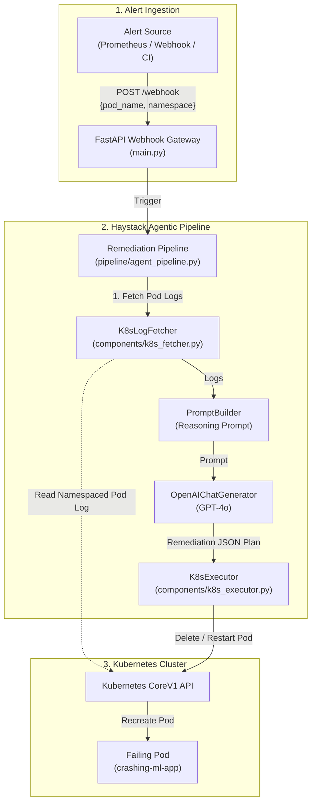

# Agentic MLOps Platform: Autonomous Kubernetes Self-Healing Gateway

An intelligent, agentic MLOps platform that monitors Kubernetes workloads, investigates failures in real time, and executes autonomous self-healing remediation actions using **Haystack AI** and **OpenAI GPT-4o**.

---

## 📌 What is This Project?

In production MLOps and cloud environments, distributed workloads and inference services frequently encounter transient issues, memory exhaustion (`OOMKilled`), configuration drift, or dependency timeouts.

Traditionally, on-call engineers must manually inspect logs, diagnose root causes, and perform repetitive mitigation (e.g., restarting pods, scaling deployments, rollback).

**Agentic MLOps Platform** bridges monitoring and operational response by acting as an **Autonomous Site Reliability Agent**:
1. **Listens** for webhook alerts (from Alertmanager, Grafana, Datadog, or custom monitors).
2. **Inspects** the live Kubernetes cluster to retrieve tail logs from failing pods.
3. **Reasons** over the failure context using an LLM-powered Haystack AI pipeline.
4. **Executes** targeted corrective actions (e.g., pod eviction/restart) directly on the cluster.

---

## 🏗️ Architecture & Workflow



---

## 📁 Repository Structure

```text
agentic-mlops-platform/
├── components/
│   ├── __init__.py
│   ├── k8s_fetcher.py        # Haystack component: connects to K8s API to pull pod logs
│   └── k8s_executor.py       # Haystack component: executes remediation actions (e.g., restart_pod)
├── k8s/
│   └── test_deployment.yaml  # Test deployment simulating an ML service crashing with OOM
├── pipeline/
│   ├── __init__.py
│   └── agent_pipeline.py     # Haystack AI pipeline connecting Fetcher -> LLM -> Executor
├── .gitignore                # Git ignore rules for venv, secrets, and cache
├── main.py                   # FastAPI application hosting the /webhook alert gateway
├── README.md                 # Project documentation
└── requirements.txt          # Python dependencies
```

---

## ⚡ Tech Stack

- **Framework**: [FastAPI](https://fastapi.tiangolo.com/) & [Uvicorn](https://www.uvicorn.org/)
- **Agent Orchestration**: [Haystack AI 3.x](https://haystack.deepset.ai/) (`Pipeline`, `PromptBuilder`, `OpenAIChatGenerator`)
- **LLM Reasoning**: OpenAI GPT-4o
- **Cluster Management**: [Kubernetes Python Client](https://github.com/kubernetes-client/python) (`CoreV1Api`)
- **Data Validation**: [Pydantic v2](https://docs.pydantic.dev/)

---

## 🚀 Getting Started

### 1. Prerequisites

- **Python 3.10+**
- **Kubernetes Cluster**:
  - **Docker Desktop** (with *Enable Kubernetes* turned on under *Settings > Kubernetes*), or
  - **Minikube** (`minikube start`), or
  - Any cluster with a valid `~/.kube/config`.
- **OpenAI API Key** with access to GPT-4o.

---

### 2. Environment Setup

Clone the repository and set up a virtual environment:

```powershell
# Windows (PowerShell)
python -m venv .venv
.\.venv\Scripts\Activate.ps1

# Install required dependencies
pip install -r requirements.txt
```

---

### 3. Deploy the Test Crashing Workload

Deploy the sample failing workload to your Kubernetes cluster:

```powershell
kubectl apply -f k8s/test_deployment.yaml
```

Check the status of the crashing pod:
```powershell
kubectl get pods -l app=crashing-ml-app
```
*(The pod will start, log `"FATAL ERROR: Out of memory (OOMKilled)"`, and exit with code 1).*

---

### 4. Run the Webhook Gateway

Set your OpenAI API key and start the FastAPI gateway:

```powershell
# Set API Key in PowerShell
$env:OPENAI_API_KEY="sk-your-openai-key"

# Start server
python main.py
```
The server will start listening at `http://0.0.0.0:8000`. Interactive OpenAPI documentation will be accessible at `http://localhost:8000/docs`.

---

### 5. Trigger Autonomous Remediation

In a separate terminal, fetch the running pod name and send an alert to the `/webhook` endpoint:

```powershell
# 1. Retrieve the pod name
$POD_NAME = (kubectl get pods -l app=crashing-ml-app -o jsonpath="{.items[0].metadata.name}")

# 2. Trigger the remediation webhook
curl.exe -X POST "http://localhost:8000/webhook" `
  -H "Content-Type: application/json" `
  -d "{`"pod_name`": `"$POD_NAME`", `"namespace`": `"default`"}"
```

#### Example Webhook Response:
```json
{
  "status": "Remediation Pipeline Executed",
  "action_taken": {
    "executor": {
      "result": "Successfully deleted pod crashing-ml-app-6bbbc9cb4-x7z9q in default"
    }
  }
}
```

The Kubernetes Deployment controller will immediately spin up a fresh pod replica, completing the autonomous self-healing cycle.

---

## 📡 API Reference

### `POST /webhook`

Receives an operational alert and initiates the Haystack auto-remediation pipeline.

**Request Body:**
```json
{
  "pod_name": "crashing-ml-app-6bbbc9cb4-x7z9q",
  "namespace": "default",
  "alert_name": "PodCrashAlert"
}
```

**Responses:**
- `200 OK`: Returns status and executor action output.
- `400 / 500`: Returns error message if OpenAI API key or cluster is unreachable.

---

## 🔮 Roadmap & Extensions

- [ ] **Dynamic Resource Patching**: Allow the agent to automatically increase memory limits in the deployment spec on recurrent OOM errors.
- [ ] **Slack / PagerDuty Notifications**: Add notification components to dispatch post-incident summaries.
- [ ] **Vector Store Incident Memory**: Integrate a vector database (e.g. Qdrant / Chroma) to recall past incident resolutions and improve diagnosis accuracy.
